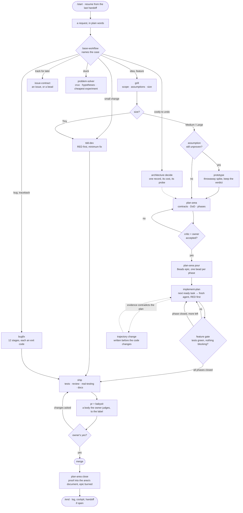
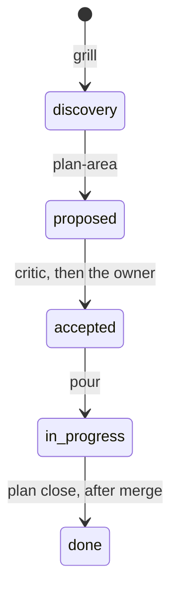

# Polaris

**Agent skills that take work from an idea to a merged, proven change, and remember where it stopped.**

Coding agents are fast and forgetful. They build before anyone agreed what "done" means, say "it
works" without proof, lose the thread between sessions and bury the tracker in issues nobody reads.
Polaris gives every step an owner (a skill) and every handoff a check a command can run, and keeps
every plan, decision and proof in your repository, so the next session resumes from files instead
of memory.

```
  DISCOVER       DEFINE         BREAK DOWN      BUILD          VERIFY          SHIP
 ┌────────┐    ┌────────┐     ┌────────┐     ┌────────┐     ┌────────┐     ┌────────┐
 │  Idea  │──▶ │  Plan  │ ──▶ │ Beads  │ ──▶ │  RED   │ ──▶ │  Real  │ ──▶ │ Merge  │
 │ Scope  │    │  DoD   │     │  epic  │     │  first │     │  test  │     │ on yes │
 └────────┘    └────────┘     └────────┘     └────────┘     └────────┘     └────────┘
   grill       plan-area      plan-area      implement-plan   review         ship
   prototype   critic         pour           tdd-dev          real-testing   pr · babysit
```

The size of the work picks the path: a bug or a small change goes test-first straight to a pull
request; a large change walks every phase. The skills run in Claude Code, Codex and any agent CLI the
[skills CLI](https://github.com/vercel-labs/skills) supports.

---

## The complete workflow



Every arrow out of a diamond is a check a command can run: a gate that exits non-zero, a receipt
bound to the tree, or the owner's explicit yes. The rest of this page explains each box.

---

## What you say, what runs

You never call the chain by hand. Say what you want; the router skill `base-workflow` names the case,
invokes the skill that owns it, and when that skill ends proposes the next one.

| What you're doing | Say, or run | Skill that owns it | Key principle |
|---|---|---|---|
| Start or resume a session | `/start` | `start` | Resume from files, not memory |
| Bring in an idea | "grill this idea" | `grill` | Scope and assumptions before code |
| Settle one open question | "prototype it" | `prototype` | Throwaway code, keep only the verdict |
| Get unstuck | "we're stuck" | `problem-solver` | Find the crux, run the cheapest telling experiment |
| Plan scoped work | "plan it" | `plan-area` | One plan file, a falsifiable outcome |
| Decide something costly to undo | `/architecture decide` | `architecture` | Few records, each with its cost |
| Build an accepted plan | "build it" | `implement-plan` | Each phase closed by a gate |
| Change behaviour | "add X" | `tdd-dev` | A test seen failing first |
| Fix a bug | paste the traceback | `bugfix` | Reproduce, don't assume |
| Finish the work | "ship it" | `ship` | Proven on the real product, merged on the owner's yes |
| Track something for later | "open an issue" | `issue-contract` | Few issues; everything else is a bead |
| Save progress | `/end checkpoint` · `/end` | `end` | Leave one concrete next action |

---

## Quick start

**1. Install the skills**, globally, into every agent CLI on the machine:

```bash
npx skills add legacynik/polaris -g --skill '*'
```

**2. Install the dependencies.** `git`, `gh` (authenticated) and `python3` ≥ 3.9 are assumed. One
command adds the rest (Beads, browser-harness, Serena) and wires the MCP servers (Serena, Context7,
Sequential Thinking, ai-memory) and hooks into each agent CLI it finds, through that CLI's own
commands. It shows what it would do first:

```bash
python3 ~/.agents/skills/init/scripts/install_deps.py deps            # dry-run
python3 ~/.agents/skills/init/scripts/install_deps.py deps --apply    # install
python3 ~/.agents/skills/init/scripts/install_deps.py doctor          # read-only check, any time
```

Only Beads (`bd`) is required, by the planning, building and tracking skills. Everything else is
optional: a skill without it says what it skipped.

**3. Bring a repository in.** In the product repository, run `init`. It writes the contract
`_polaris/config.yml`, finds the areas and drafts the live documents. Then `/start`: the first run
creates your own folder, `_polaris/team/<your-github-login>/`, and prints where you left off.

**Update** with `npx skills update -g -y`. What changed in each release, and what to remove when
upgrading, is in the [release notes](https://github.com/legacynik/polaris/releases).

<details>
<summary><b>Claude Code plugin</b></summary>

The same skills are published as a plugin marketplace. Use either the plugin or the skills CLI on one
machine, not both: a skill installed twice is listed twice.

```text
/plugin marketplace add legacynik/polaris
/plugin install polaris-team-os@polaris-team-os
```

</details>

<details>
<summary><b>Codex, pi, omo, Hermes and other agent CLIs</b></summary>

The skills CLI links the skills into every supported agent CLI it finds; Codex reads them from
`~/.agents/skills`. For a CLI it does not support, clone this repository and point the CLI at
`polaris/skills/`. Skills find their own scripts through
`${CLAUDE_PLUGIN_ROOT:-$HOME/.agents}/skills/<skill>/`, so set `CLAUDE_PLUGIN_ROOT` to the clone's
`polaris/` directory. The dependency installer prints the MCP lines for CLIs whose command is
interactive (Hermes) instead of running them.

</details>

---

## How Polaris works

Each section below is the whole explanation; nothing else needs to be read.

<details>
<summary><b>Size picks the path</b>, and the eight phases</summary>

`grill` proposes the size. The first row that matches wins; the owner can override it in one word.

| Size | First match wins | Path |
|---|---|---|
| Large | a new external dependency, public interface or data contract; an irreversible step (migration, deletion, pricing); or more than one area | every phase |
| Medium | more than one PR, or a contract changes inside one area | every phase; Prototype only while an assumption is unproven |
| Tiny | one PR, no new interface or contract, no decision | a bead with its acceptance → `tdd-dev` → `ship`; no plan |
| Bug | a defect with a reproduction | `bugfix` → `ship`; no plan |

Every phase ends on something a command can check:

| # | Phase | Skill | What it leaves behind | It ends when |
|---|---|---|---|---|
| 1 | Discover | `grill` | a plan file at `status: discovery`: area, why, prior art, scope in and out, assumptions with how to test each | the owner agrees scope and assumptions |
| 2 | Prototype | `prototype` | a verdict in the plan; the spike code is thrown away | one named question has an answer |
| 3 | Define | `plan-area`, `critic` | contracts, Definition of Done, regression checks, approach | `critic` finds nothing blocking and the owner sets `accepted` |
| 4 | Break down | `plan-area pour` | a Beads epic, one bead per phase, real `blocks` edges | every DoD line maps to a task |
| 5 | Build | `implement-plan`, `tdd-dev` | closed phase beads, each with a test seen failing first | the feature gate closes each phase |
| 6 | Correct course | `plan-area` | a dated *Trajectory change* in the plan, written before the code changes | the entry cites evidence |
| 7 | Ship | `ship`, `pr`, `babysit` | a merged pull request | the owner approves on the PR |
| 8 | Close | `plan-area close` | what the work proved, moved into the area's main document; the plan in `done/` | nothing of this work is left open |

An autonomous loop may take Tiny and Bug work labelled `afk:eligible`, and build a Medium plan once
its owner set it to `accepted`. Work labelled `risk:high` (migrations, pricing, anything
irreversible) never enters the loop.

</details>

<details>
<summary><b>Gates</b>: which checks run where, and why most run only once</summary>

A gate runs where its cost buys something. Small phases close on tests alone; the expensive checks
run once, on the pull request, where a person judges.

| | Tiny | Medium | Large |
|---|---|---|---|
| `critic` on the plan | — | once | once, and on each decision record |
| each Beads phase | — | tests green, nothing open blocking it | the same |
| the pull request | tests · `review` · `real-testing` locally | the same, then `real-testing` on staging once | the same |

- **RED first.** `tdd-dev` records the failing test bound to the test file's hash before any fix; a
  test rewritten after its RED does not count.
- **Phases close only through the gate.** `feature_gate.py` refuses a phase whose tests fail or that
  an open finding blocks; `fix_gate.py` does the same for `bugfix`. There is no `--force`.
- **The real product, not the diff.** `real-testing` serves the commit, walks the customer journey
  through the real UI, and lets a fresh agent try to break it. Its receipt is bound to the tree:
  change the code and it expires.
- **Six-axis review.** `review` checks that tests prove behaviour, nothing drifts from a decision,
  constraints hold, the plan's DoD is met (no less, no more), the code is simple, and it is secure.

</details>

<details>
<summary><b>A worked example</b>: one feature and one bug, end to end</summary>

**"Customers should be able to export their quotes as PDF."**

1. `base-workflow` sees an idea and calls `grill`. It reads the repository's docs and decisions,
   checks how other products did it, and asks one question per turn: *which quotes, which layout,
   who downloads it?* It writes `docs/areas/quotes/plans/open/2026-10-27-pdf-export.md` with scope in
   and out and each assumption tagged `assumed`, and proposes **Medium**.
2. One assumption, *"the HTML renderer handles our tables"*, is still assumed: `prototype` spikes it on
   a throwaway branch and writes only the verdict into the plan.
3. `plan-area` adds contracts, the DoD and three phases; `critic` attacks the plan from a fresh
   context; the owner sets `accepted`; `plan-area pour` creates the Beads epic.
4. `implement-plan` takes each ready task, hands it to a fresh agent that records a failing test
   first, and closes each phase through the gate.
5. `ship` runs the tests, `review` and `real-testing`, updates the docs the diff made stale, opens the
   PR with a body from `pr`, and `babysit` drives it to the owner's label. The owner merges.
6. `plan-area close` moves what the plan proved into the area's main document.

**"This traceback appears when the customer has no VAT number."** `base-workflow` calls `bugfix`:
twelve stages, each passed by an exit code. It reproduces without assuming the cause, writes the
failing test, fixes, proves the consequence, rewrites the tests that missed it, files side findings
as beads, then hands over to `ship`. No plan file.

</details>

<details>
<summary><b>What Polaris keeps in your repository</b>: <code>_polaris/</code>, areas and live documents</summary>

Everything lives in the product repository, committed with the code. The package holds only
workflow, never project data.

```text
your-repo/
├── CONTEXT.md                  # the language: every term with one meaning
├── ARCHITECTURE.md             # a high-level map: components, boundaries, invariants
├── DOMAIN.md                   # domains and components, with stable ids
├── docs/areas/<area>/          # one folder per stable part of the system
│   ├── README.md               # where to start, what the area does not own
│   ├── <area>.md               # the area's main document: how it works today
│   ├── module-context.json     # the files an agent loads by default here
│   ├── CHANGELOG.md            # accepted changes, linked to evidence
│   └── plans/open/ · done/     # plan files; specs/, validation/, diagrams/, archive/ when needed
└── _polaris/
    ├── config.yml              # the contract: tracker, document map, ship and real-test settings
    ├── decisions.md            # the decision ledger, newest on top
    ├── decisions/              # decisions that must be enacted, each with a probe
    ├── records/                # lessons, written only by scripts/lesson_record.py
    ├── state/current.md        # the cockpit: priorities and who works on what
    └── team/<login>/           # yours, created by your first /start
        ├── profile.yml         # exact GitHub login, language, voice
        ├── weeks/              # weekly plan and report
        ├── sessions/           # one log per day, one entry per checkpoint
        └── handoff/            # what is still open when your lane stops
```

| `config.yml` key | Meaning |
|---|---|
| `outputs.<kind>` | where each document kind lands: plan, spec, audit, review, validation, diagram, decision, archive |
| `tracker.*` | the GitHub repository and the labels for work a person must do and work an agent may claim |
| `ship.*` | the repository's ship cycle: verify command, environments, rollback, owner label |
| `real_test.*` | how `real-testing` serves and walks the product: staging, health, smoke, browser profile |

A skill that needs a key the file does not declare says so instead of guessing.

**Areas.** An area is a stable part of the system that outlives any one piece of work; a feature, a
bug or a mechanical change does not get one. **How documents age:** born in their area; when a plan
closes, what it proved moves into the area's main document and the plan moves to `done/`; a document
whose claims no longer hold moves to `archive/`, never deleted. A path a document cites must exist
when it is read, or it is reported `STALE`.

</details>

<details>
<summary><b>The plan file</b>: one per Medium or Large piece of work</summary>

The plan holds spec and plan together: the stable contract lives in the file, the moving state
(phases, tasks, findings) in Beads. **One open plan per area**: a second idea for the same area waits
as a bead labelled `kind:idea`, which stops plans piling up unread.

| Section | Written by | Contents |
|---|---|---|
| Executive | `grill`, `plan-area` | a few lines for a person: outcome, decision, risk |
| 1 Area · 2 Why and outcome | `grill` | the owning area; a success criterion that can be proved false |
| 3 Discovery | `grill` | prior art with sources, what we already own, scope in and out, assumptions with their tests |
| 4 Prototype verdicts | `prototype` | the answer to each named question |
| 5 Contracts · 6 DoD | `plan-area` | interfaces, error paths, examples; each DoD line with the evidence that could refute it |
| 7 Approach · 8 Links | `plan-area` | `### Phase N` with its tasks; issues, epic, decisions |
| 9 Trajectory changes | `plan-area` | dated: what proved wrong · evidence · what changes |

Every claim in sections 3–7 is `assumed` or `proven: <test | receipt | PR | path>`; a `proven:`
pointer to a missing path is refused.



Any open plan can also be `paused` (reason, date, slot freed) or `abandoned`.

</details>

<details>
<summary><b>Work tracking</b>: GitHub for deliveries, Beads for everything else, nothing mirrored</summary>

| Home | What goes there |
|---|---|
| **GitHub issue** | deliveries a person schedules or approves, or a customer sees: few, readable by a human |
| **Beads** (`bd`) | everything operational: plan phases and tasks, Tiny work, bugs found while testing, review findings, follow-ups, spikes, waiting ideas |

`issue-contract` is the only door. It opens a GitHub issue only when **all** hold: a person must
schedule or approve it; it will not be done inside the current PR or phase; it says how to prove it
done and names an area; no open issue already covers it. Otherwise it creates a bead and says why.

Beads gives real `blocks` edges (`bd ready` lists only unblocked work), claims with leases that
expire when a worker crashes, phases poured from a formula and closed only through the gate, and an
epic burned at merge so nothing rots. Never a mirror between GitHub and Beads: an earlier trial
produced hundreds of beads nobody read.

</details>

<details>
<summary><b>Decisions and documents</b>: few records, a living document per area</summary>

Sort each statement by one question: **what does it take to undo this?**

| Kind | The test | Where it goes |
|---|---|---|
| **Decision** | undoing it takes more than a commit: stored data, something a customer or another system relies on, money, a vendor; or it supersedes an earlier decision | `decisions.md`, a decision file, or an ADR |
| **Spec** | how something works or must be built | the plan, or the area's main document |
| **Detail** | a real choice, cheap to undo: a name, a threshold, a tool | the PR, a CHANGELOG line, a code comment |

- **A line in `decisions.md`** for most decisions, thresholds, methods and prompts included: chose ·
  over · because · evidence · supersedes · impact.
- **A decision file** when the choice must be enacted. It carries a `probe` (the command that proves
  it is in effect) and `probe_kills` (a call site whose removal must make the probe fail).
- **An ADR** only for a decision that shapes the system: its structure, non-functional
  characteristics, dependencies, interfaces or construction techniques. ADRs live in
  `docs/adr/NNNN-title.md`, numbered in sequence, one or two pages each: Status · Context (the forces,
  as facts) · Decision ("We will…") · Consequences (all of them, not only the good ones). ADR 0001 of
  every repository is the one that records how ADRs are written.
- **The ADR set stays small and current**, so each one describes the system as it is: drift (a path,
  a name, a count) is amended in place without changing what was decided; a reversal is a new ADR
  that supersedes the old one, linked both ways; overlapping or dead records are compacted from time
  to time, with git as the archive. An ADR never grows dated "update" sections.
- **How it works today** lives in two documents that already exist, never in a record:
  `ARCHITECTURE.md`, a short map of the whole repository, and each area's main document
  (`docs/areas/<area>/<area>.md`), which walks that area's flow step by step and is updated when a
  plan closes. Both name files, not functions: the detail is the code.

Records are written by `/architecture decide`, never by hand. Status runs `proposed` → `accepted`
(the owner) → `executed` (only when the probe passes): `accepted` is the target, the code is reality.

</details>

<details>
<summary><b>Sessions, lessons and the week</b>: how work resumes from files alone</summary>

- **`start` resumes, it does not survey.** It reads your profile and weekly plan, the cockpit, your
  newest session log, the goals, the last five decisions, and a radar for handoffs other worktrees
  left, then prints one brief. It never fetches or writes the cockpit.
- **`end` checkpoints and closes.** Each call appends a log entry (done with proof · in progress ·
  next · blocker · key context · files) and rewrites your line in the cockpit. The close prunes the
  cockpit against git and the tracker, brings the day's session logs onto the default branch, and
  writes a handoff only while work is still open. It commits only what it wrote and never pushes.
- **Lessons become checks.** Lessons are written only by `scripts/lesson_record.py`. When the same
  family of mistake recurs, `end` opens a bead naming the check to build; a lesson that never becomes
  a check is just a note.
- **The week.** `/week` writes your weekly plan from real issues and PRs, and at the end reports plan
  against reality. The lead may reorder it; silence is not a block.

</details>

<details>
<summary><b>Context and memory</b>: what an agent knows before it acts, and how far to trust it</summary>

| Layer | Answers | Trust it as |
|---|---|---|
| **Context pack** | what is in force for this work, now: live documents, decisions in force for the area, the area's files | authority, checked when read |
| **Agent memory** (ai-memory) | what did we discuss, try or learn before | history: a lead, never proof |
| **Knowledge base** | what do trusted outside sources say | reference, with its source named |

The context pack is a list of rows, each saying why it entered and whether it is known true: `sealed`
rows from committed files, `declared` prose nobody proved fresh, `flight` rows of work in progress
(news, never authority), and `UNKNOWN` for an authority the work needs and the repository lacks. It
loads when work enters an area and has a token budget; after a context compaction a hook reprints the
same pack without recomputing it.

Agent memory captures sessions automatically; `grill`, `plan-area` and `implement-plan` ask it for
earlier attempts. Everything recalled is untrusted text, and decisions, plans, current state and
lessons never live in memory: memory may remember that something was discussed, the files say what
was decided, and the code says whether it was done.

</details>

---

## All 27 skills

Each `SKILL.md` is the authority for its own behaviour.

### Route

| Skill | What it does | Use when |
|---|---|---|
| `base-workflow` | Names the case, invokes the skill that owns it, proposes the next one | Any request that touches code, a plan or the tracker |

### Discover and define

| Skill | What it does | Use when |
|---|---|---|
| `grill` | Grills an idea against the repo, earlier ideas and prior art; scope, assumptions with tests, size; opens the plan | An idea, a feature request, a vague spec |
| `prototype` | Answers one named question with throwaway code on a spike branch; keeps only the verdict | A plan assumption is still assumed and code can settle it |
| `problem-solver` | Stops the loop, restates the problem, finds the crux, generates many hypotheses, searches prior art, picks the cheapest experiment that tells them apart | Repeated failed attempts, a fix budget says STOP, "we're stuck", a plan to flip |
| `plan-area` | One plan file per piece of work; pours its phases into a gated Beads epic; records course changes; closes after merge | Scoped Medium or Large work |
| `architecture` | Decides one architectural commitment and records its cost; audits, maps and documents the system | A boundary, interface, data contract or dependency moves; architecture docs are stale |
| `domain` | Names the domain, removes overloaded terms, types subdomains, maps contexts | A term means two things, or two models must integrate |
| `database-schema` | Reads the real schema before a query or migration is designed | Any work that touches the database |

### Build

| Skill | What it does | Use when |
|---|---|---|
| `implement-plan` | Builds an accepted plan phase by phase from `bd ready`, each task to a fresh agent, RED first | A plan is accepted and its epic poured, or a build crashed |
| `tdd-dev` | One behaviour change test-first: a hash-bound RED, the minimum fix, a break proving the test guards the code | Implementing a behaviour change or a reproducible fix |
| `bugfix` | Closes a bug through twelve stages, each passed by an exit code, with a fix-loop breaker | A traceback, a red smoke, "this doesn't work" |

### Verify

| Skill | What it does | Use when |
|---|---|---|
| `review` | Audits a diff on six axes; second-opinion mode asks another model family | Before a commit, a PR or a merge |
| `real-testing` | Serves the commit, walks the journey in the real UI on every surface, lets a fresh agent try to break it | Before merge or promotion; "test the app" |
| `critic` | Attacks a plan, decision or claim from a fresh context; only quoted, falsified findings survive | Before accepting a plan or relying on a claim |
| `crasher` | Hunts the deployed app for crashes; proposes deduplicated findings for a person to pick | After a deploy, or on a schedule |
| `eval` | Measures prompts, agents and skills: golden sets, graders, calibrated judges, a skill with and without | Something must be measured, or two versions compared |

### Ship

| Skill | What it does | Use when |
|---|---|---|
| `ship` | Tests, audits, real-tests, updates stale docs, opens the PR, merges on the owner's yes | The work is done |
| `pr` | Writes a PR body the owner judges without reading code: verdict, criteria with proof, risk | Writing or rewriting a PR body |
| `babysit` | Drives an open PR to the owner's label: checks, comments, conflicts | A PR is open and must land |
| `git-power` | Safe commits, PR boundaries and destructive Git; censuses worktrees, branches and stashes | Any commit, PR boundary or `reset --hard` |

### Track and words

| Skill | What it does | Use when |
|---|---|---|
| `issue-contract` | The one door to the tracker: an issue only when it passes the filter, otherwise a bead | "Open an issue", "track this" |
| `prompt-engineering` | Writes the words a model reads: system prompts, dispatches, judge text; hands them to `eval` | A prompt must be written or fixed |

### Session

| Skill | What it does | Use when |
|---|---|---|
| `start` | Resumes from the latest handoff, read-only; opens the session | Session start, "where were we" |
| `end` | Checkpoints or closes the session: log, cockpit line, lessons, handoff | "Checkpoint", "wrap up" |
| `status` | The repository's pulse: lanes, collisions, decisions not yet done | "Where are we" across the team |
| `week` | The weekly plan from real work, and the report against it | Monday and Friday |
| `init` | Brings a repository into Polaris: contract, areas, live documents; installs dependencies | First setup of a repository or a machine |

---

## How a skill is built

```
┌─ SKILL.md (≤ 60 lines) ─────────────────────────────┐
│  name · version · description: "◇ Polaris — …       │
│                  Use when … Requires …"              │
│  What it does   → one paragraph                      │
│  When           → the triggers                       │
│  Steps          → numbered, each ends on a check     │
│  Output         → what it leaves, and the next skill │
│  Not for        → where it stops                     │
├──────────────────────────────────────────────────────┤
│  references/  detail loaded only when a step needs it│
│  scripts/     the gates: exit codes, --selfcheck     │
│  eval/        trigger and behaviour cases            │
│  CHANGELOG.md every change bumps the version         │
└──────────────────────────────────────────────────────┘
```

- **Steps, not prose.** A skill is a procedure with exit criteria, not an essay.
- **The check is a command.** Where a step can be cheated, a script decides with an exit code.
- **Short and disclosed.** The body stays under 60 lines; detail loads only when a step needs it.
- **Measured.** A new skill, or a changed description, is promoted only when its trigger cases do not
  regress; `eval` can measure how much a skill helps by running a task with and without it.

## Repository layout

| Path | What it holds |
|---|---|
| `polaris/skills/` | the 27 skills |
| `polaris/scripts/` | the context-pack resolver and the package checks |
| `polaris/tests/` | the package contract tests |
| `.claude-plugin/`, `polaris/.claude-plugin/` | marketplace and plugin manifests |
| `docs/` | one page per structure, the same content as the sections above |

Skills are developed in a private lab and promoted here only through the release gates: English, no
private names or paths, the 60-line form, a version above the published one with its CHANGELOG
entry, declared dependencies, and trigger evals for new or re-described skills. CI runs the contract
tests, every script's `--selfcheck`, the skill markers and the version check.

## Contributing

Skills should be specific (steps, not advice), verifiable (each step ends on a check), tested on
real work, and minimal. How to propose a change and the gates it must pass:
[CONTRIBUTING.md](CONTRIBUTING.md).

## License

MIT.
