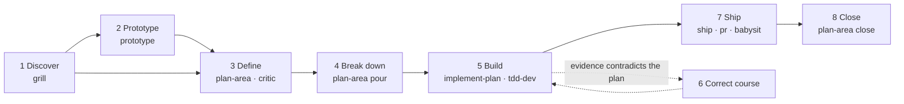

# Delivery cycle

How a piece of work goes from an idea to a merged pull request. The size of the work picks the
path; the router skill `base-workflow` names the case and hands it to the skill that owns it.

## Size picks the path

`grill` proposes the size from these criteria. The first row that matches wins; the owner can
override it in one word.

| Size | First match wins | Path |
|---|---|---|
| Large | a new external dependency, public interface or data contract; an irreversible step (migration, deletion, pricing); or more than one area | every phase below |
| Medium | more than one PR, or a contract changes inside one area | every phase except Prototype, which runs only while an assumption is still unproven |
| Tiny | one PR, no new interface or contract, no decision | a bead with its acceptance → `tdd-dev` → `ship`; no plan file |
| Bug | a defect with a reproduction | `bugfix` → `ship`; no plan file |

## The phases

| # | Phase | What it leaves behind | It ends when |
|---|---|---|---|
| 1 | Discover | a plan file at `status: discovery`: area, why, prior art, scope in and out, assumptions with how to test each | the owner agrees scope and assumptions |
| 2 | Prototype | a verdict in the plan file; the spike code is thrown away | one named question has an answer |
| 3 | Define | the plan file complete: contracts, Definition of Done, regression checks, approach | `critic` finds nothing blocking and the owner sets `accepted` |
| 4 | Break down | a Beads epic, one bead per phase, real `blocks` edges | every DoD line maps to a task |
| 5 | Build | closed phase beads, each with a test that was seen failing first | the feature gate closes each phase |
| 6 | Correct course | a dated *Trajectory change* entry in the plan, written before the code changes | the entry cites evidence |
| 7 | Ship | a merged PR | the owner approves on the PR |
| 8 | Close | the proven content absorbed into the area's main document; the plan moved to `done/`; the epic burned | nothing of this work is left open |

## Gates, and what each one costs

A gate runs where its cost buys something. Small Beads phases close on tests alone; the expensive
checks run once, on the pull request, where a person judges.

| | Tiny | Medium | Large |
|---|---|---|---|
| `critic` on the plan | — | once | once, and once on each decision record |
| each Beads phase | — | tests green, nothing open blocking it | tests green, nothing open blocking it |
| the pull request | tests · `review` on the diff · `real-testing` locally | tests · `review` · `real-testing` locally, then on staging once | tests · `review` · `real-testing` locally, then on staging once |

`feature_gate.py` (in `plan-area`) enforces the phase rows: `pour` creates the epic, `close --step`
refuses a phase whose tests fail or that an open finding blocks. `fix_gate.py` does the same for
`bugfix`. A `--force` on a phase close is not allowed.

## The router

`base-workflow` is loaded at the start of any request that touches code, a plan or the tracker. It
names the case (idea, bug, scoped work, accepted plan, small change, decision, finished work, "track
this"), invokes the owning skill, and when that skill ends proposes the next one or stops and asks
with the options. Nobody has to remember the chain.

## Who may run it unattended

An autonomous loop takes Tiny and Bug work labelled `afk:eligible`. One exception: once the owner
sets a Medium plan to `accepted`, the loop may build its phases from `bd ready` and close it after
its own merge. Work labelled `risk:high` (migrations, pricing, anything irreversible) never enters
the loop.
