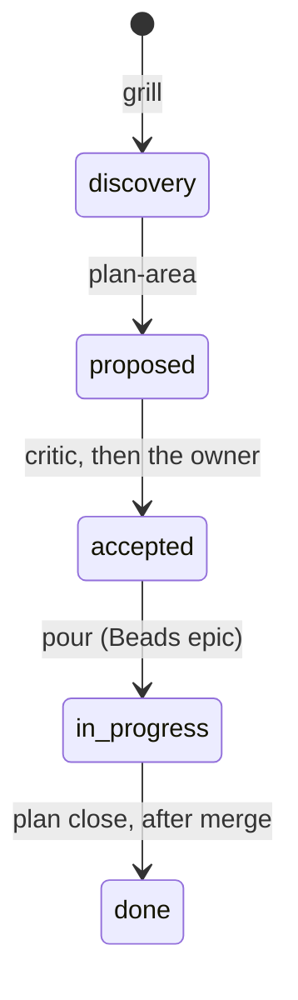

# Plan file

One file per piece of Medium or Large work. It holds the spec and the plan together: the stable
contract lives in the file, the moving state (phases, tasks, findings) lives in Beads.

## Where it lives

`docs/<areas|modules>/<area>/plans/open/<YYYY-MM-DD>-<name>.md`. The area is resolved first, from
`config.yml` `outputs.plan` and the area map; an unknown area is asked once.

**One open plan per area.** A second idea for the same area waits as a bead labelled `kind:idea`
until the slot frees. This is what stops plans piling up unread.

## What is in it

| Section | Written by | Contents |
|---|---|---|
| Executive | `grill`, then `plan-area` | a few lines for a person: outcome, decision, risk, what to read |
| 1 Area | `grill` | the area and why it owns this work |
| 2 Why and outcome | `grill` | a success criterion that can be proved false |
| 3 Discovery | `grill` | prior art with primary sources, what we already own, scope in and out, assumptions with how to test each |
| 4 Prototype verdicts | `prototype` | the answer to each named question; the spike code is gone |
| 5 Contracts | `plan-area` | interfaces, error paths, acceptance examples, executable where possible |
| 6 DoD and regression checks | `plan-area` | each line pairs a result with the evidence that could refute it |
| 7 Approach | `plan-area` | `### Phase N: title` headings with their tasks |
| 8 Links | `plan-area` | issues, the Beads epic, decisions, by name |
| 9 Trajectory changes | `plan-area` | dated: what proved wrong · evidence · what changes |

Every claim in sections 3 to 7 is tagged `assumed` or `proven: <test | receipt | verdict | PR |
path>`. `check_plan_files.py --gate` refuses a `proven:` pointer to a path that does not exist.

## Its states

Any open status can also move to `paused` or `abandoned`.

| status | Where the file is | What it means |
|---|---|---|
| `discovery` · `proposed` · `accepted` · `in-progress` | `open/` | the work is alive and holds the area slot |
| `done` | `done/` | merged; its proven content is now in the area's main document |
| `paused` | `archive/paused/` | stopped with a reason and a date; a `kind:idea` bead keeps the way back; the slot is free |
| `abandoned` | `archive/` | stopped for good, with a one-line reason and a digest bead |

`status:` is required from the first line written. Only `plan_close.py` writes `done` or
`abandoned`; `ship` calls it after the merge.

## Changing course

When evidence contradicts the plan, the change is written in section 9 **before** the code
changes, and it cites the evidence. A decision that changes is superseded by a new record, never
edited (see [decision-records.md](decision-records.md)).
