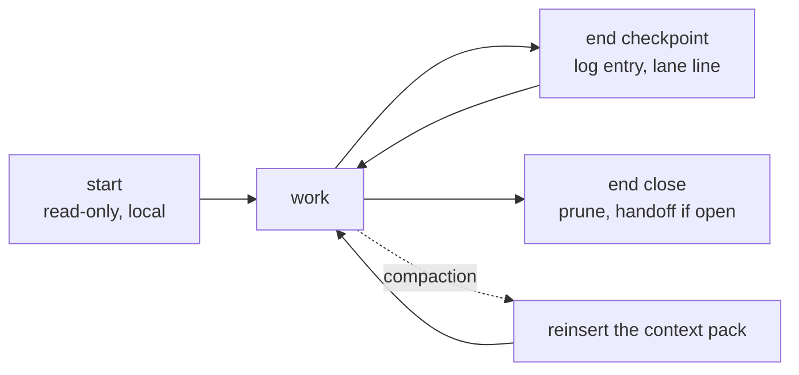

# Sessions

How a session resumes from files alone, what it leaves for the next one, and how a mistake becomes
a check. What the agent remembers across sessions is in [memory.md](memory.md).

## Where each thing lives

| Thing | Home | Written by |
|---|---|---|
| current priorities and lanes (who works on what, on which branch) | `state/current.md`, the cockpit: one per repository | `end` |
| next actions · goals | `state/todos.md` · `state/goals.md` | `end`, the owner |
| what happened in a session | `team/<login>/sessions/<date>-@<login>.md`, one entry per checkpoint | `end` |
| what is still open when a lane stops | `team/<login>/handoff/<date>.md`, only while the lane has open work | `end` (close) |
| work in progress | GitHub and Beads (see [work-tracking.md](work-tracking.md)) | the skills |
| a fact learned from a failure | `records/`, through `scripts/lesson_record.py` | `end`, any skill |
| history of past sessions, for recall | the agent memory (see [memory.md](memory.md)) | automatic |

## A session

- **`start` resumes, it does not survey.** It reads only the resume set: the contributor's profile
  and weekly plan, the cockpit, the newest own session log, the goals, the last five decisions, and
  a radar for handoffs other worktrees left behind. It opens the session and prints one brief. It
  never fetches, scans pull requests or writes the cockpit.
- **`end` checkpoints and closes.** Each call appends a log entry with six fields (done with proof ·
  in progress · next · blocker · key context · files) and rewrites the contributor's own lane line
  in the cockpit. The close also prunes the cockpit against git and the tracker, and writes a handoff
  only while the lane still has open work. It commits only the paths it wrote and never pushes.

## Lessons become checks

A lesson is written only by `scripts/lesson_record.py`; `record_gate.py` refuses a hand edit. When
the same family of mistake recurs, or a mistake caused an incident, `end` opens a bead
(`kind:followup src:lesson`) naming the check to build. A lesson that never becomes a check is a
note.

