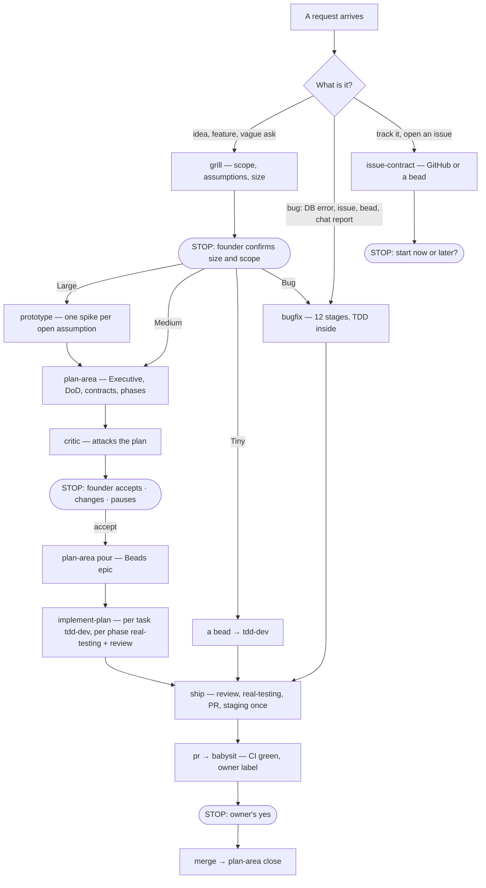

# Chains — which skill follows which, why and when to stop

The map `base-workflow` proposes from, so the person never has to remember the order. At the end
of every skill its `**Next:**` line names the next step; at a **STOP** the agent asks the person,
offering the options listed here (the harness's question tool when it has one). Sizes and phases
are the operating model's §2–§3; this file only names the hand-offs.

| Situation | Chain | Why | Stop and ask when |
|---|---|---|---|
| An idea or a vague request | `grill` → by size | the size picks the path; nothing is built before scope is agreed | after `grill`: size and scope |
| Large work | `prototype` → `plan-area` → `critic` → pour → `implement-plan` → `ship` | an open assumption is settled with code before it is planned on | after `critic`: accept the plan |
| Medium work | `plan-area` → `critic` → pour → `implement-plan` → `ship` | more than one PR or a contract: it needs phases and a DoD | after `critic`: accept the plan |
| Tiny work | a bead → `tdd-dev` → `ship` | one PR, no contract: a plan would be ceremony | before merge only |
| A bug, from any origin | `bugfix` → `ship` | the 12 stages prove cause and consequence | fix-loop breaker over 20; before merge |
| Design moves a boundary, interface, contract or dependency | `architecture` (with `domain`, `database-schema`) → back to the caller | an irreversible choice is recorded before code depends on it | when the choice is one-way |
| Evidence contradicts the plan | `plan-area` Trajectory change → back to `implement-plan` | the plan stays the contract; code follows it | when scope or DoD changes |
| Work to track, not to do now | `issue-contract` → GitHub or a bead | only deliveries a person schedules reach GitHub | always: start now or later |
| Work finished, any size | `ship` → `pr` → `babysit` | one coordinator owns the order | the owner's yes before merge |
| A deployed app to check | `crasher` → `issue-contract` for confirmed crashes | findings are proposed, never filed alone | which finding to pick |
| Words a model reads | `prompt-engineering` → `eval` | a prompt is better only when measured | when the eval regresses |
| An external source already read | `reference-capture` | one dossier per source | — |

Inside a skill the chain is the skill's own: `implement-plan` runs `tdd-dev`, `real-testing` and
`review` per phase; `ship` runs `review`, `real-testing`, `pr`, `babysit`; `bugfix` runs
`tdd-dev` and `real-testing`. Skills never launch the next one across a STOP.
