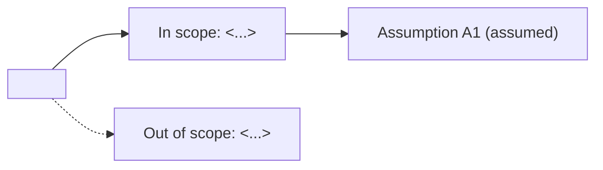

<!-- One skeleton for the whole life of the file: grill writes sections 1–3 at discovery; plan,
prototype and plan close fill the rest. feature_gate.py parses the frontmatter, the `## 6.` bullets,
the `### Phase N:` headings under `## 7.` and the `Beads epic:` line under `## 8.` — keep those shapes. -->

# <title>

## Executive

For whoever reads first, a few lines: problem → outcome, what to decide, the biggest risk, and which
sections to read for the review (e.g. DoD §6, contracts §5, open assumptions §3).

## 1. Area

The area and how it was resolved (`config.yml` outputs + the area map, or the founder's answer).

## 2. Why and outcome

Why now, for whom. The outcome as a falsifiable success criterion: what is observed, where, and
the threshold that says it worked.

## 3. Discovery

- **Prior art** — how others solved it, each with its primary source and what it does better.
- **What we already own** — code, skills, decisions or plans that cover part of it.
- **Scope in / out** — explicit lists.
- **Assumptions** — `A1 <claim> — test: <command, spike or measurement> — assumed`; a proven one
  reads `proven: <test | receipt | verdict | PR>`.

## 4. Prototype verdicts

<prototype writes one `### V<n> — <question>` block per spike, or "none needed">

## 5. Contracts

<plan: interfaces, error paths, acceptance examples — executable where possible, each tagged>

## 6. DoD and regression checks

- <plan: given input/context, the observable result> — evidence: <what could refute it>
- Regression: <existing behaviour to preserve>

## 7. Approach

### Phase 1: <plan: the observable result of this phase>
- <task>

## 8. Links

- Beads epic: <written by pour>
- Issues: <#N, deliveries only, via issue-contract>
- Decisions: <DEC ids this plan enacts; plan close promotes them>

## 9. Trajectory changes

- <YYYY-MM-DD · what proved wrong · evidence · what changes>
