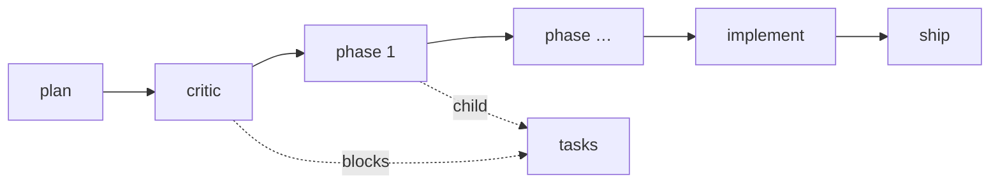

# Beads rules for a plan's epic

Source: the Beads adoption tests, `docs/modules/polaris-harness/validation/2026-10-24-beads-adoption-tests.md`
(bd 1.3.1), §3. Each rule below is there because a test falsified the looser version.

| Rule | Why |
|---|---|
| **Pour, never wisp.** `feature_gate.py pour` runs `bd mol pour feature`. | A wisp step takes no lease: heartbeat refuses it and `bd reclaim` never sees it, so a crashed loop leaves its phase `in_progress` until someone uses `--force` (§2.4). |
| **Claim through the gate.** `feature_gate.py claim --step <id>` reaps expired leases of this molecule (`bd reclaim --older-than 0s --id …`), then `bd update --claim`. Heartbeat (`bd heartbeat <id>`) every ~2 min while holding it. | The lease TTL is fixed at 5 min upstream. Proven on a throwaway db: a `kill -9`'d claimant's step was freed after the TTL and taken by a second actor; the dead owner's heartbeat was refused. |
| **Close only through the gate.** `feature_gate.py close --step <id>`. Never `bd close` / `bd update --status closed` on a stage or phase bead, never `bd close --continue` (it auto-claims the next step). Tasks close with plain `bd close`; a phase cannot close while a child is open. | bd knows no judge (§2.2): "close only through the wrapper" is a rule plus the gate's checks. |
| **No `--force` on close or update, no `bd dep add/remove` on molecule steps.** `bd mol burn --force` (confirmation skip) is the gate's own. | `bd dep remove` unblocked a phase with no `--force` (§2.1). The gate diffs the live `blocks` edges against the formula and the plan's phase chain and refuses any close while one is missing. |
| **Scope every read by the molecule.** `bd ready --mol <epic>`, `bd mol show <epic>`. | Unscoped `bd ready --json` on a real db cost ~1k tokens per issue (§2.9). |
| **Merge → burn; abandon → digest, then burn.** `feature_gate.py finish` (called by `plan_close.py`). | The squash digest of a merged run adds nothing to the PR comment (§2.7). `bd mol squash` writes nothing for a poured molecule (no ephemeral children — verified), so at abandon the gate writes the same digest itself: every step, its status and close reason, in phase order, as a closed `kind:digest` bead. |
| **A finding is a child of the EPIC**, filed `--parent <epic> --deps discovered-from:<phase>,blocks:<phase>`. Tasks are children of their phase and close with plain `bd close` (no `--continue`, no `--force`). | bd 1.3.1 allows one dependency per pair: a child of the phase cannot also be `discovered-from` it. The `blocks` edge makes the phase wait; `edges` checks only for missing edges, so this extra one passes. |
| **Claim one step with the gate; claim tasks with `--parent`.** `bd ready --mol X --claim` is refused (`--claim cannot be combined with --mol`); `bd ready --parent <epic> --claim` works and takes a lease. | Measured by B2 on bd 1.3.1. |
| **Findings carry their own provenance.** Put `gh#N` (or the plan name) in the finding's description, `external_ref` when promoted. | Squash and burn delete the `discovered-from` edges pointing at the molecule (§2.8). |
| **A task waits on what its phase waits on.** `pour` gives each task `blocked-by:<the phase's predecessor>` (critic for phase 1, phase N-1 for phase N); `edges` checks those edges too. | bd does not pass a parent's blockers to its children: before this, `bd ready --mol` listed every phase's tasks right after pour, with critic still open (measured by B2). |
| **The formula is the skill's.** `pour` installs `formulas/feature.formula.toml` into `.beads/formulas/` and refuses a copy that drifted. | bd discovers only `<name>.formula.toml` in `.beads/formulas/` (a bare `feature.toml` is not listed — verified); a locally weakened copy would change the edges the gate checks. |

## The molecule

Stage → artifact (`feature_gate.py check --stage …`):

| Stage | Passes only with |
|---|---|
| `plan` | file in `plans/open/`, `area:` and `tests:` set, a DoD line, ≥1 phase, `status: accepted|in-progress`, `Beads epic:` that exists, `check_plan_files.py` clean for this file |
| `critic` | `--report`: `critic_gate.py --validate` exit 0 and no `critical`/`important` finding |
| `phase` | the plan's `tests:` exits 0 · no open bead blocks the phase. No review, no real-test: both run once on the PR (founder, 2026-10-26) |
| `implement` | every phase bead of the molecule closed |
| `ship` | `--pr`: MERGED, and a real-test receipt comment for the merged head |

After `pour`, close the `plan` and `critic` steps through the gate:
`feature_gate.py close --step <id> --record <plan> --repo . [--report]`.
