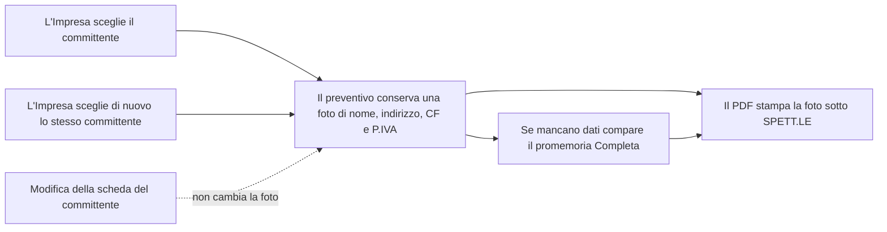

## In breve

Il PDF del preventivo ora intesta il preventivo al committente: sotto «SPETT.LE» stampa nome, indirizzo, codice fiscale e P.IVA, fotografati quando l'Impresa sceglie il committente. Se mancano dei dati compare un promemoria «Completa» e il PDF si scarica comunque. La stessa tornata corregge tre difetti trovati dal real-test («Completo» in ritardo di 5 secondi, «Annulla» che voleva due clic, l'amministratore del condominio che non arrivava al PDF), l'errore di download in inglese (#1207) e le segnalazioni di errore del frontend che il backend rifiutava (#792).

**Decisione richiesta:** non ancora · prima 1) applicare la migrazione `20261018100000` in produzione, 2) controllare perché il diff cancella i documenti dell'area prezzario-multiregione (vedi «Cosa resta aperto»), 3) decidere se accettare i punti aperti di #1719 e #1207, poi merge, poi deploy.

| Controllo | Esito |
|---|---|
| Issue | #792 3/3 criteri ✅ · #1719 2/7 (5 ❌ → issue da aprire) · #1207 3/9 (6 ❌ → issue da aprire) |
| Real-test | MERGEABLE-CON-GAP · staging `ad76031ae` · due revisori Opus a contesto fresco, browser dedicato |
| CI | verde (backend 4 blocchi, frontend 4 blocchi, lint, tsc) · test visti rossi prima: 5 · `supabase-migrations-check` rosso anche prima di questa PR |
| Porta · raggio | two-way se si rispetta l'ordine · computi |
| Aperto | 7 |

Closes #792
Refs #1719
Refs #1207

## Criteri delle issue

I criteri senza prova nel fascicolo del real-test sono segnati ❌, anche se il codice potrebbe già coprirli: vanno provati o spostati in una issue prima di chiudere.

### #1719 Il PDF intesta il preventivo al committente: blocco «Spettabile» congelato all'invio

| # | Criterio (dall'issue) | Esito | Prova |
|---|---|---|---|
| 1 | Il PDF stampa nome, indirizzo, CF e P.IVA dalla foto; `pytest` copre privato, ditta individuale, società, condominio | ❌ | Provati sul vivo privato, azienda, condominio; la ditta individuale non è stata percorsa su staging |
| 2 | Modificare il committente dopo l'invio non cambia il PDF; un nuovo invio prende i dati nuovi | ✅ | Ricevuta: la foto resta dopo una modifica della scheda, «Completa» la rifà; la foto si scatta alla scelta, non all'invio (vedi Decisioni) |
| 3 | Dato fiscale mancante: 1 riga di promemoria «Manca la P.IVA · Aggiungi», PDF mai bloccato, `vitest` asserisce il pulsante attivo | ❌ | Il promemoria c'è ma dice «Dati da completare: … · Completa»; il test sul pulsante sempre abilitato non è nel fascicolo |
| 4 | Nessun disclaimer AI, 0 trattini lunghi nel blocco | ✅ | Testo del PDF qui sotto, CI verde |
| 5 | 4 PDF confrontati con 4 computi reali dell'Impresa pilota | ❌ | Non fatto |
| 6 | Committente con il solo nome: 1 riga, nessuna etichetta vuota, `None` assente | ❌ | Prova non registrata; il solo nome non si salva da interfaccia dal #1718 |
| 7 | I test dell'intestazione visti rossi prima e verdi dopo | ❌ | Rosso registrato per le correzioni della tornata, non per i test dei primi commit; il file è `backend/tests/test_intestazione_committente.py`, non quello nominato nell'issue |

**Aperti: 1, 3, 5, 6, 7 → issue da aprire**

### #1207 Scaricando il PDF senza Partita IVA l'impresa vede il JSON grezzo dell'errore

| # | Criterio (dall'issue) | Esito | Prova |
|---|---|---|---|
| 1 | Un errore JSON `{"detail": ...}` diventa solo il testo; caso 400 con P.IVA, nessun `{` né `400` | ❌ | Prova non registrata nella ricevuta |
| 2 | Link o pulsante verso `/impostazioni` accanto al messaggio, 1 screenshot | ❌ | Non verificato |
| 3 | Corpo non JSON o vuoto: una frase italiana, caso 502 HTML | ✅ | Test `frontend/tests/unit/download-preventivo-errore.test.tsx` (msw), CI verde |
| 4 | 5 corpi diversi, nessuno mostra `{`, `detail` o codice di stato | ❌ | Prova non registrata |
| 5 | Browser sulla preview, account senza P.IVA, PDF XLSX e CSV: 3 messaggi leggibili | ❌ | Non fatto |
| 6 | Un 5xx non mostra mai il testo del backend (`T.scaricaFallito`) | ✅ | `frontend/tests/unit/quote-actions-errors.test.ts` |
| 7 | Il 500 porta una frase italiana e logga l'eccezione in `error_log` | ✅ | `backend/tests/test_export_fallito_non_mostra_eccezione.py`, rosso poi verde (PDF, XLSX, CSV) |
| 8 | 4 casi: 4xx italiano mostrato, 500 inglese, 502 HTML, 503 vuoto nascosti | ❌ | Coperti i 5xx, il 4xx mostrato non è registrato |
| 9 | Render forzato a fallire: il dialogo mostra il testo italiano, screenshot | ❌ | Nessuno screenshot nel fascicolo |

**Aperti: 1, 2, 4, 5, 8, 9 → issue da aprire**

### #792 reportClientError non ha MAI funzionato: manda un payload che l'endpoint rifiuta con 422

Issue senza caselle: righe = «Fix» 1-3.

| # | Criterio (dall'issue) | Esito | Prova |
|---|---|---|---|
| 1 | Codice `client.unexpected_error` accettato dall'elenco dei codici segnalabili | ✅ | Il test di contratto passa con il codice che il frontend manda |
| 2 | `reportClientError` manda `{code, message, context}` entro i limiti | ✅ | `frontend/tests/unit/client-error-reporter.test.ts` |
| 3 | Test di contratto che fallisce se i due payload divergono | ✅ | `backend/tests/test_api_client_error_dal_frontend.py` con `client_error_dal_frontend.json`: rosso 422, poi verde 204 |

**Tutti i criteri di #792 sono chiusi.**

## Cosa cambia



Legenda: la foto è la colonna `quotes.committente_intestazione`; la scheda è il record del committente.

Il PDF, prima e dopo (testo estratto con `pdftotext`):

```diff
 SPETT.LE
 
-BK1719 Condominio Ciliegi
+BK1719 Condominio Ciliegi
+c.a. Amministratore Studio BK1719 Verd
+Via dei Ciliegi 3
+31100 Treviso (TV)
+C.F. 02345678904
```

| Pezzo | Cosa fa |
|---|---|
| `20261018100000_quotes_committente_intestazione.sql` | Aggiunge la colonna della foto, opzionale |
| `quote_committente.py`, `quotes.py` | Salvano la foto alla scelta; sceglierne di nuovo lo stesso la rifà |
| `pdf.py`, `destinatario.html` | Stampano le righe dell'intestazione, con «c.a.» per il condominio |
| `title_extractor.py` | Il titolo del preventivo porta il giorno in italiano |
| `StatoCommittente.tsx`, `salva-identita.ts` | «Completo» compare appena la risposta di salvataggio arriva (74 ms invece di 5 s) |
| `chiudi-dopo-il-clic.ts`, `CampoCommittente.tsx`, `CambiaCommittente.tsx` | «Annulla» chiude con un clic anche a lista aperta, nel pannello e nel dialogo PDF |
| `CampoCommittente.tsx`, `ritorno.ts` | Con due committenti dallo stesso nome, Invio non ne sceglie nessuno; lo stesso già collegato scelto di nuovo chiude «Cambia» |
| `quote-actions-errors.ts`, `quotes.py` | Un download fallito mostra una frase italiana, l'eccezione va in `error_log` |
| `client-error-reporter.ts` e test | Il frontend manda ciò che l'endpoint accetta |
| `piva.ts` | L'errore di checksum della P.IVA dice cosa fare |
| `version.py`, `versions.json` | Release v6.4.0: registra #1878, #1892, #1728, già in produzione |

## Decisioni

- **ADR:** `docs/adr/2026-08-31-committente-cantiere-commessa.md` §2.6 (il PDF legge la foto, mai la chiave), §8.3 (il committente intesta il PDF), §8.4 (ciò che manca è un promemoria, mai un blocco), §10.5, §10.7, §11 · seguito · `docs/adr/2026-09-13-domande-rare-assunzioni-visibili-pdf-pulito.md` (niente disclaimer AI sul PDF) · seguito · `docs/copy/MICROCOPY.md` R6.2 (niente testo tecnico a schermo) · seguito. Il file dell'ADR 2026-08-31 è stato ritoccato in 6 righe.
- **Scelta:** la foto si scatta alla scelta del committente invece che all'invio, perché ogni modifica successiva della scheda non può cambiare un PDF già emesso; la differenza con il titolo dell'issue («congelato all'invio») va confermata.
- **Scelta:** sceglierne di nuovo lo stesso committente rifà la foto, perché senza questo l'amministratore del condominio aggiunto sulla scheda dopo il collegamento non raggiungeva mai il PDF.
- **Scelta:** il promemoria dice «Dati da completare: … · Completa» invece di «Manca la P.IVA · Aggiungi», perché copre tutti i dati mancanti con una sola riga.

## Prove

Provato dal vivo: sì, staging con il backend del branch e la preview, SHA `ad76031ae`, migrazione applicata su staging (run 39143361455). Il commit `e45cbbe09` aggiunge solo i file di prova.

**1. «Completo» subito dopo aver creato un'azienda completa da «Cambia»**


**2. «Cambia» con la lista dei suggerimenti aperta, prima del clic su «Annulla»**


**3. Dopo un solo clic su «Annulla» l'editor è chiuso**


**4. Due committenti con lo stesso nome e Invio: non ne viene scelto nessuno**


**5. Dialogo PDF con la lista aperta**


**6. Dialogo PDF chiuso con un clic su «Annulla»**


- **Prima → dopo:** tutti visti rossi prima, verdi dopo: il download fallito (500) ora dice una frase italiana e logga l'eccezione, per PDF, XLSX e CSV · la segnalazione di errore del frontend passa da 422 a 204 · Invio con due nomi uguali non sceglie nessuno · «Annulla» chiude con un clic a lista aperta · «Completo» compare senza ricaricare mentre le letture sono ferme.
- **Real-test:** staging con il backend del branch e preview, SHA `ad76031ae`; due revisori Opus a contesto fresco su Chrome dedicato, account `qa@example.com`, nulla validato. Il primo, su `3c30a81e3`, ha verificato l'intero contratto (PDF per azienda, privato e condominio; da A a B e un nome sopra un preventivo già collegato non stampano mai i dati di A; omonimi; segnalazioni di errore; copy della P.IVA; telefono 390×844 senza scorrimento orizzontale) e ha trovato 3 difetti, corretti in `ad76031ae`: «Completo» in ritardo, «Annulla» a due clic, amministratore del condominio irraggiungibile. Il secondo, su `ad76031ae`, li ha visti passare; da A a B e omonimi passano ancora. Non sono difetti: il nome semplice non salvabile da interfaccia (voluto dal #1718), il bersaglio di «Annulla» (56×21, area di tocco 44 px), l'emoji assente dal PDF (carattere). Verdetto: MERGEABLE-CON-GAP. Prove in `.real-test/evidence/1942-ad76031ae/` e `1942-locale-fix/`.

## Cosa resta aperto

- Su staging, con risposte 502 e da 6 a 10 secondi, il primo PDF dopo aver scelto di nuovo lo stesso committente ha stampato una volta la foto vecchia (1 volta su 2). Sul backend del branch 5 cicli su 5 danno la foto nuova · da accettare o da indagare, decide il fondatore · prima del deploy
- Confronto affiancato con 4 computi reali dell'Impresa pilota (#1719, criterio 5) · da fare · prima del deploy
- Ditta individuale mai percorsa su staging (#1719, criterio 1) · da fare · prima del deploy
- Link verso `/impostazioni` accanto al messaggio sulla P.IVA mancante (#1207, criterio 2) non verificato · da fare · prima del deploy
- Criteri senza prova nel fascicolo (#1719: 3, 6, 7; #1207: 1, 4, 5, 8, 9) · chi ha costruito la PR li prova o li sposta in una issue · prima del merge
- Il diff cancella circa 4.400 righe di documenti dell'area prezzario-multiregione (ADR del 2026-10-16, manifesti Puglia e Toscana, validazioni Lombardia e Piemonte, ROADMAP), mentre `main` ha già altri lavori su quell'area (#1930, #1937, #1938) · da verificare, probabile ramo non aggiornato con `main` · prima del merge
- `supabase-migrations-check` rosso anche prima di questa PR: staging ha 4 migrazioni di altre lane non ancora su `main` · da chiudere nelle lane che le portano · non blocca questa PR

## Rischio del merge

**Porta:** two-way se si rispetta l'ordine · **Raggio:** computi

La migrazione aggiunge una colonna opzionale: è reversibile, ma un `main` messo in produzione senza la colonna rompe ogni scelta del committente, perché il salvataggio la scrive. Ordine: migrazione in produzione, poi merge, poi deploy.

Un deploy di produzione oggi porta anche questa PR e ciò che `main` ha dopo `4dd343db9` (in produzione adesso): #1934 (correzione chat 404), #1930, #1937 e #1938 (strumenti del prezzario regionale), #1941 (documenti). La release v6.4.0 registra #1878, #1892 e #1728, già in produzione. La migrazione è applicata su staging, non ancora in produzione.

Closes #792
Refs #1719
Refs #1207

🤖 Generated with [Claude Code](https://claude.com/claude-code)

https://claude.ai/code/session_018Mn6wYKp5aaZQt3TNdEdRj
